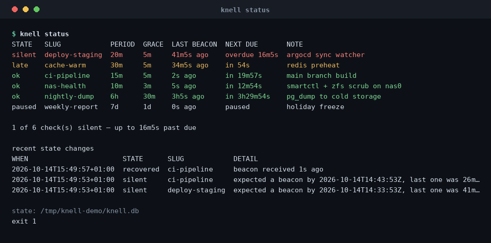
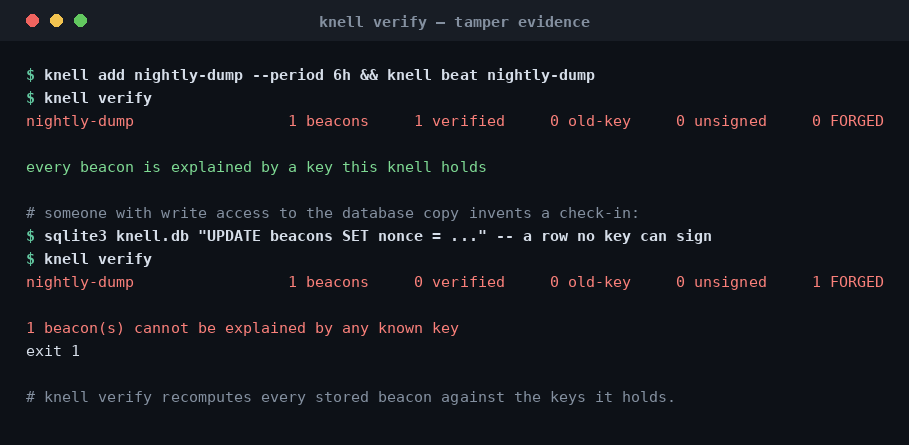

```
 _               _ _
| | ___ __   ___| | |          .-"""-.
| |/ / '_ \ / _ \ | |         /  .-.  \      a dead man's switch
|   <| | | |  __/ | |         |  | |  |      for the jobs you forgot
|_|\_\_| |_|\___|_|_|          \  '-'  /     to watch.
                                '-...-'
                                  o
```

# knell

[](https://github.com/0xCyrildev/knell/actions/workflows/ci.yml)
[](https://go.dev)

**Your backup job didn't fail. It just stopped talking — and nothing noticed.**

knell is the small tool that notices. A job checks in with one signed line. If a
check-in goes missing past its grace window, `knell check` exits `1`, and cron, CI, or
whatever you pipe it into finally knows something is wrong. It's the local-first,
no-account, one-binary version of DeadMansSnitch: your state is a SQLite file on your
disk, not somebody's dashboard.

No daemon required. No account. No outbound calls. One dependency (a pure-Go SQLite),
and it cross-compiles to a static binary for five platforms.

## Sixty seconds

```console
$ knell add nightly-dump --period 6h --grace 30m --note 'pg_dump to cold storage'
added nightly-dump: expect a beacon every 6h, alert after 30m of silence

$ knell beat nightly-dump                    # ... in the job, or in its crontab
recorded beacon for nightly-dump at 2026-10-14T15:49:56+01:00

$ knell check --all
silent  deploy-staging  20m  5m  41m3s ago  overdue 16m3s  argocd sync watcher
ok      nightly-dump    6h   30m 3h3s ago   in 3h29m56s    pg_dump to cold storage
exit 1
```

That `1` is the whole product. Nothing failed. Something stopped talking.



## What you'd actually put in a crontab

```cron
# check in at the end of the job
0 3 * * *   /usr/local/bin/backup && /usr/local/bin/knell beat nightly-backup --quiet

# or let knell wrap it: the job keeps its own exit code, and knell checks in on failure
*/15 * * * * knell beat ci-pipeline --on failure -- /srv/deploy.sh

# and one line that decides whether anything has gone quiet
*/5 * * * *  knell check --all --quiet || logger -t knell "a scheduled job went silent"
```

`knell beat job -- <command>` is the part I keep using: knell runs your job, records a
beacon according to how it ended, and exits with **the job's** code — so you can't
accidentally teach cron to trust the watcher instead of the work.

## Beacons are signed, and that turns out to matter

Anyone can `curl` a monitoring endpoint and claim their job ran. So a knell beacon
carries an HMAC-SHA256 over `slug + timestamp + nonce`, checked in constant time, with
replay stopped twice over — an in-memory nonce cache, and a durable unique constraint
that survives a restart. Which means knell can also answer a question a normal monitor
can't: *is this history real?*

```console
$ knell verify
nightly-dump     1 beacons   1 verified   0 old-key   0 unsigned   0 FORGED

every beacon is explained by a key this knell holds
```

Edit a row by hand and it stops being a row — it becomes evidence.



Signing keys live in their own `0600` file, *not* in the database, because the database
is the thing you back up, attach to a ticket, and mount somewhere you'd rather not send
keys.

## The contract

| exit | meaning |
|---|---|
| `0` | everything asked about is inside its grace window |
| `1` | at least one check is **silent** |
| `2` | knell couldn't decide — bad flags, unreadable state, an unknown check name, or nothing configured at all |

That last row is the design, honestly: a monitoring tool that answers "all good" when it
isn't watching anything is worse than one that refuses to answer. `knell check ghost`
exits `2`, not `0`.

## Install

```console
go install github.com/0xCyrildev/knell/cmd/knell@latest   # or:
make build && sudo make install                            # static, CGO off
docker build -t knell . && docker run -v knell:/data -e KNELL_ADMIN_TOKEN=... knell
```

Single host? Done — `knell beat` writes straight to `~/.local/share/knell/knell.db`.
Fleet of cron boxes? Run `knell serve` once somewhere and point the agents at it with
`knell beat --url https://knell.example`; the agent needs a secret and a URL, nothing
else. It binds to `127.0.0.1` by default, speaks plain HTTP, and expects a reverse proxy
to handle TLS — there is no unsigned beacon mode, from any address, because "it came from
localhost" is not a capability check.

`GET /metrics` is Prometheus text, `/healthz` is honest, `knell ping` is the health check
the distroless image runs, and every report has a `--json` shape that matches the HTTP
API so a dashboard and a cron job can never disagree.

## What it is not

Not a job runner, not an APM, not a notification product (it records what went quiet and
hands one shell command the details — getting that to Slack is your 15-line script), not
an access-control system, and not something that phones home. It has no telemetry because
it has no network calls you didn't ask for.

## Docs

- [docs/DESIGN.md](docs/DESIGN.md) — the state model, the beacon format, and why each
  choice is there. Worth reading before you disagree with one.
- [docs/SECURITY.md](docs/SECURITY.md) — threat model, including what signing does *not*
  protect.
- [CHANGELOG.md](CHANGELOG.md) — what changed, in prose you can actually read.

MIT licensed. Issues and PRs welcome, especially the "this lied to me" kind: a tool whose
only job is to be trusted should be told loudly when it isn't.

Tests run under `-race`; `make check` is fmt + vet + race + build + a live CLI smoke.
Built by a person who got paged about a backup that had been dead for eleven days.

```
        .-"""-.
       /  .-.  \        if it's quiet, that's the alarm.
       |  | |  |
       \  '-'  /
        '-...-'
          o
```
